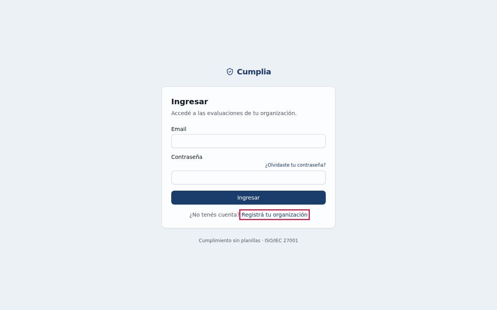
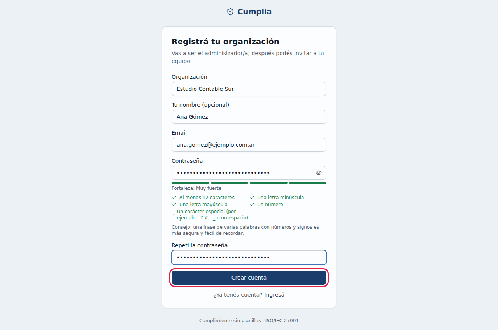
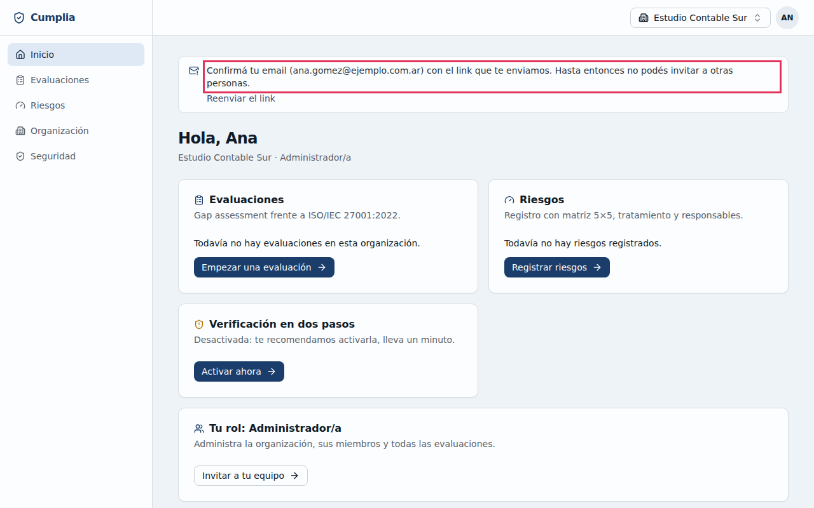
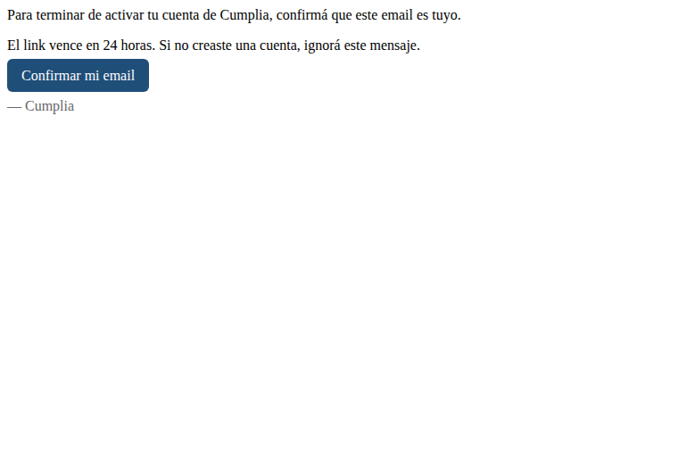
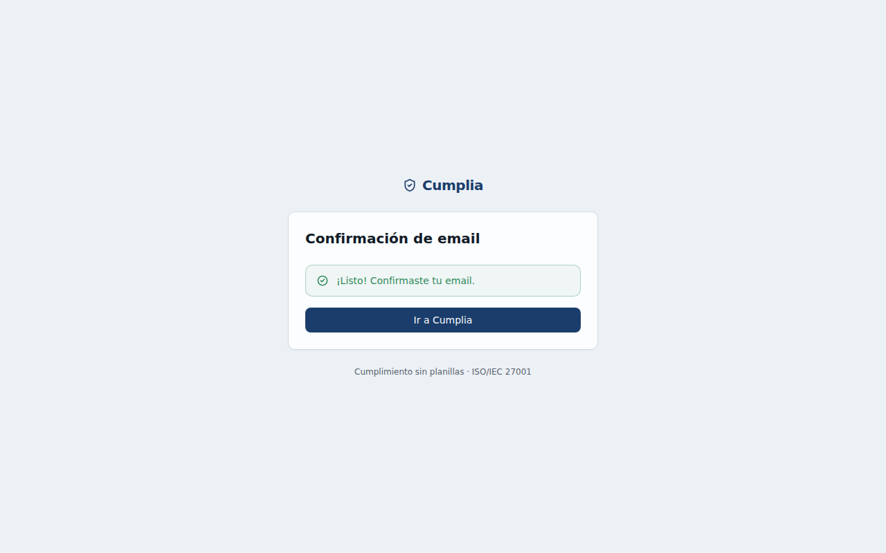
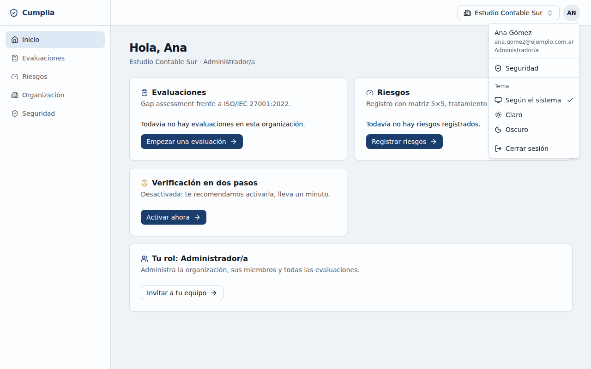
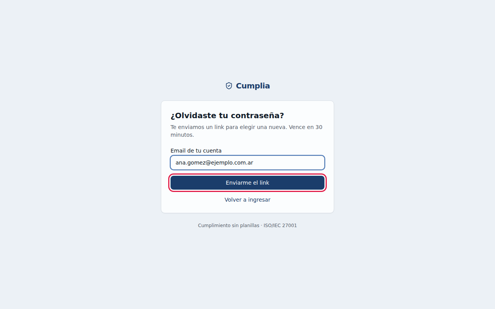

# 1. Primeros pasos

## 1.1 Crear tu cuenta y tu organización

Si sos la primera persona de tu organización en usar Cumplia, creás la cuenta y la organización a la vez. Vas a ser su **Administrador/a**. Si alguien ya te invitó, no hagas esto: seguí el link del email de invitación (ver [Aceptar una invitación](03-equipo.md#33-aceptar-una-invitación)).

1. Entrá a Cumplia y, en la pantalla de ingreso, hacé clic en **Registrá tu organización**.

   

2. Completá los datos:
   - **Organización**: el nombre de tu empresa o estudio. No puede contener links ni direcciones web.
   - **Tu nombre** (opcional, pero recomendado: así te reconoce tu equipo).
   - **Email**: el de trabajo, al que tengas acceso.
   - **Contraseña**: Cumplia te muestra en vivo qué requisitos cumple. Tiene que tener al menos 12 caracteres, mayúsculas, minúsculas, números y algún símbolo, y no puede ser una contraseña conocida ni contener tu nombre, tu email o el de la organización.
   - **Repetí la contraseña**.

3. Hacé clic en **Crear cuenta**.

   

> **Consejo:** usá un gestor de contraseñas para generar y guardar una contraseña única para Cumplia.

## 1.2 Confirmar tu email

Apenas creás la cuenta ya podés usar Cumplia. Arriba vas a ver un aviso para **confirmar tu email**: hasta que lo hagas no vas a poder invitar personas ni exportar reportes.

1. Abrí el email **"Confirmá tu email en Cumplia"** y hacé clic en **Confirmar mi email**. El link vence a las 24 horas.

   

2. Vas a ver **"¡Listo! Confirmaste tu email."**. Hacé clic en **Ir a Cumplia**.

   

¿No llegó el email? Revisá la carpeta de spam. Si no está, en el aviso de la pantalla de inicio hacé clic en **Reenviar el link**.

## 1.3 Conocer la pantalla

- **Menú de la izquierda** (en el celular, arriba): **Inicio**, **Evaluaciones**, **Riesgos**, **Organización** y **Seguridad**.
- **Arriba a la derecha**:
  - el nombre de la **organización** en la que estás trabajando (si pertenecés a varias, desde ahí cambiás de una a otra);
  - tu **menú de usuario** (el círculo con tus iniciales).
- **Inicio**: un resumen con tus evaluaciones, tus riesgos, el estado de tu verificación en dos pasos y tu rol.

En el **menú de usuario** encontrás:
- **Seguridad**.
- **Tema**: claro, oscuro o según la configuración de tu computadora.
- **Cerrar sesión**.

## 1.4 Ingresar

1. En la pantalla de ingreso, escribí tu **Email** y tu **Contraseña** y hacé clic en **Ingresar**.
2. Si tenés activa la verificación en dos pasos, Cumplia te pide el código de 6 dígitos de tu app (ver [Ingresar con el código](02-seguridad.md#22-ingresar-con-el-código)).

Por seguridad:
- Después de **5 intentos fallidos** la cuenta se bloquea **15 minutos** y te avisamos por email.
- La sesión se cierra sola tras **12 horas sin uso**, y como máximo a los 7 días.

## 1.5 Si olvidaste tu contraseña

1. En la pantalla de ingreso, hacé clic en **¿Olvidaste tu contraseña?**.
2. Escribí el **Email de tu cuenta** y hacé clic en **Enviarme el link**.

   

3. Abrí el email **"Restablecé tu contraseña de Cumplia"** y hacé clic en el link. Vence en **30 minutos** y sirve una sola vez.
4. Elegí la contraseña nueva, repetila y hacé clic en **Guardar contraseña**.

Al restablecerla, Cumplia cierra todas tus sesiones abiertas. Si tenías activa la verificación en dos pasos, al ingresar te la va a seguir pidiendo.
