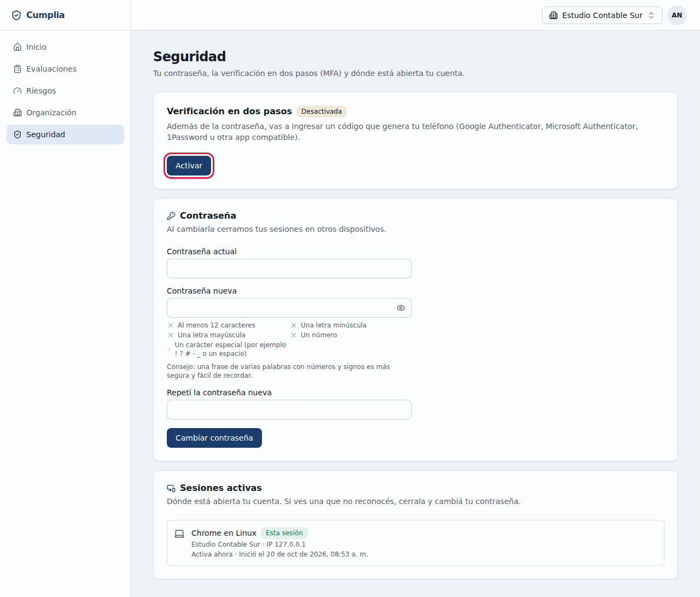
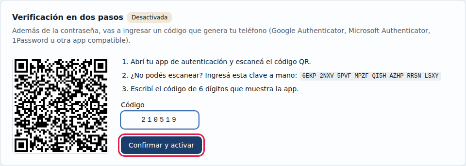
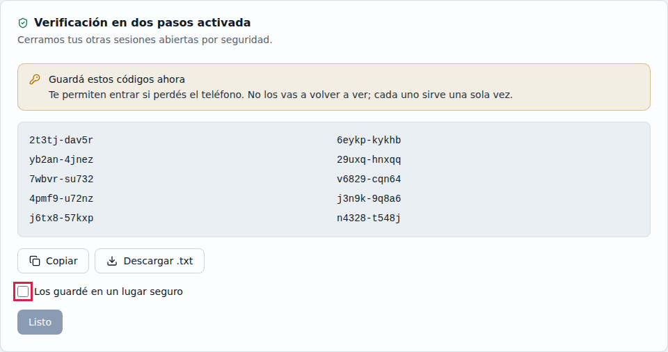
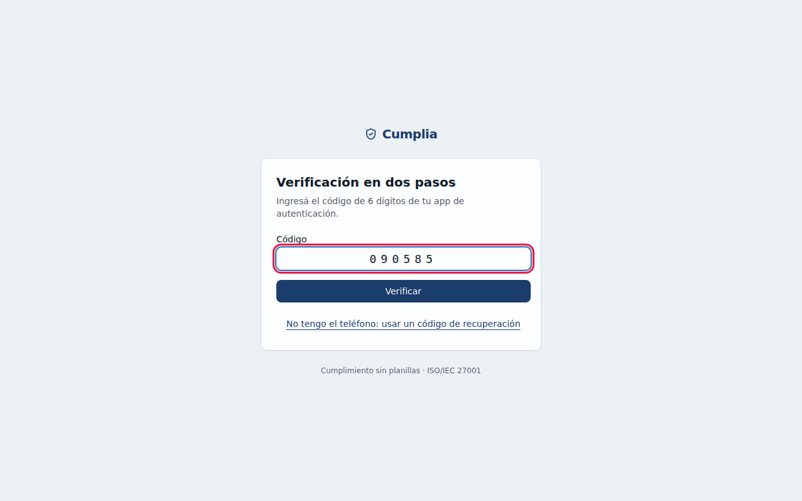
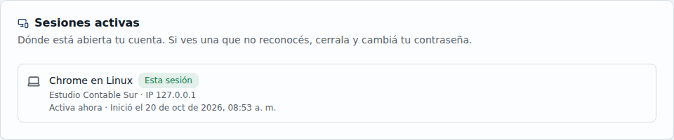
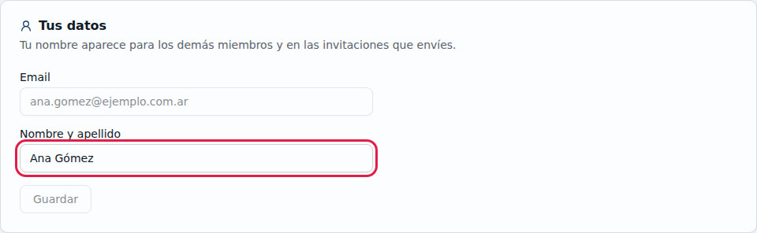

# 2. Seguridad de tu cuenta

En **Seguridad** (menú de la izquierda o tu menú de usuario) gestionás la verificación en dos pasos, tus datos, tu contraseña, tus sesiones abiertas y, si hace falta, la eliminación de tu cuenta.

## 2.1 Activar la verificación en dos pasos

Con la verificación en dos pasos (también llamada MFA), para entrar a Cumplia no alcanza con la contraseña: también hace falta un código que genera tu celular. Así, aunque alguien consiga tu contraseña, no puede entrar. **Te recomendamos activarla**; tu organización puede exigirla.

1. Instalá en tu celular una app de autenticación: Google Authenticator, Microsoft Authenticator, 1Password u otra compatible.
2. En **Seguridad**, en **Verificación en dos pasos**, hacé clic en **Activar**.
3. En la app del celular, agregá una cuenta nueva y **escaneá el código QR** que muestra Cumplia. Si no podés escanearlo, cargá a mano la clave que aparece debajo.
4. Escribí en **Código** los 6 dígitos que muestra la app y hacé clic en **Confirmar y activar**.

   

5. Cumplia te muestra **10 códigos de recuperación**. Sirven para entrar si perdés el celular. **Se muestran una sola vez**:
   - guardalos con **Descargar .txt** o **Copiar**, en un lugar seguro (por ejemplo, tu gestor de contraseñas);
   - marcá **Los guardé en un lugar seguro** y hacé clic en **Listo**.

   

Al activarla, Cumplia cierra tus otras sesiones abiertas: se habían iniciado sin el segundo paso. También te llega un email de aviso.

## 2.2 Ingresar con el código

Con la verificación activa, después de la contraseña Cumplia te pide el **Código** de 6 dígitos de tu app. Escribilo y hacé clic en **Verificar**. El código cambia cada 30 segundos y cada uno sirve una sola vez.

**¿No tenés el celular?** Hacé clic en **No tengo el teléfono: usar un código de recuperación** y escribí uno de tus códigos de recuperación. Cada código sirve una sola vez. Te avisamos por email cuántos te quedan. Si te quedan pocos, generá códigos nuevos desde **Seguridad** → **Códigos de recuperación** (con un código de tu app). Los anteriores dejan de servir.

**¿Perdiste el celular y los códigos?** Pedile ayuda al Administrador/a de tu organización (ver [Ayudar a un miembro](03-equipo.md#36-ayudar-a-un-miembro-con-su-cuenta)).

## 2.3 Cambiar tu contraseña

En **Seguridad** → **Contraseña**:
1. Escribí la **Contraseña actual**.
2. Escribí la **Contraseña nueva** y repetila.
3. Hacé clic en **Cambiar contraseña**.

Cumplia cierra tus sesiones en otros dispositivos y te avisa por email.

## 2.4 Ver y cerrar tus sesiones

En **Seguridad** → **Sesiones activas** ves desde dónde está abierta tu cuenta: dispositivo y navegador, organización, IP, última actividad y cuándo se inició. La que estás usando dice **Esta sesión**.

- Si ves una sesión que **no reconocés**, hacé clic en **Cerrar** en esa fila y después **cambiá tu contraseña**.
- **Cerrar las demás** cierra todas menos la actual: útil si usaste una computadora compartida.

## 2.5 Desactivar la verificación en dos pasos

En **Seguridad** → **Desactivar** te pedimos tu contraseña y un código de la app. No se puede desactivar si alguna de tus organizaciones la exige.

## 2.6 Corregir tu nombre

En **Seguridad** → **Tus datos**, escribí tu **Nombre y apellido** y hacé clic en **Guardar**. Tu nombre es el que ven los demás miembros y el que aparece en las invitaciones que enviás.

El email identifica tu cuenta y no se cambia desde acá. Si necesitás cambiarlo, escribinos (ver la Política de Privacidad).

## 2.7 Eliminar tu cuenta

En **Seguridad** → **Eliminar tu cuenta** → **Eliminar mi cuenta…**:
1. Escribí el email de tu cuenta para confirmar.
2. Escribí tu **Contraseña** y, si tenés la verificación en dos pasos, el **Código de tu app** (o un código de recuperación).
3. Hacé clic en **Eliminar mi cuenta para siempre**.

Se borran tus datos personales, tus sesiones y tu acceso a todas tus organizaciones, y te llega un email de confirmación. **No se puede deshacer.**

Tené en cuenta:
- Lo que cargaste en cada organización (evaluaciones, evidencia, riesgos) **es de la organización** y queda. Los riesgos a tu cargo quedan sin responsable.
- El registro de auditoría de cada organización conserva tus acciones.
- Si sos el **único Administrador/a** de una organización, Cumplia no te deja eliminar la cuenta: antes nombrá a otra persona como Administrador/a ([3.4](03-equipo.md#34-cambiar-el-rol-o-quitar-a-un-miembro)) o, si sos la única persona, eliminá la organización ([3.9](03-equipo.md#39-eliminar-la-organización)).
