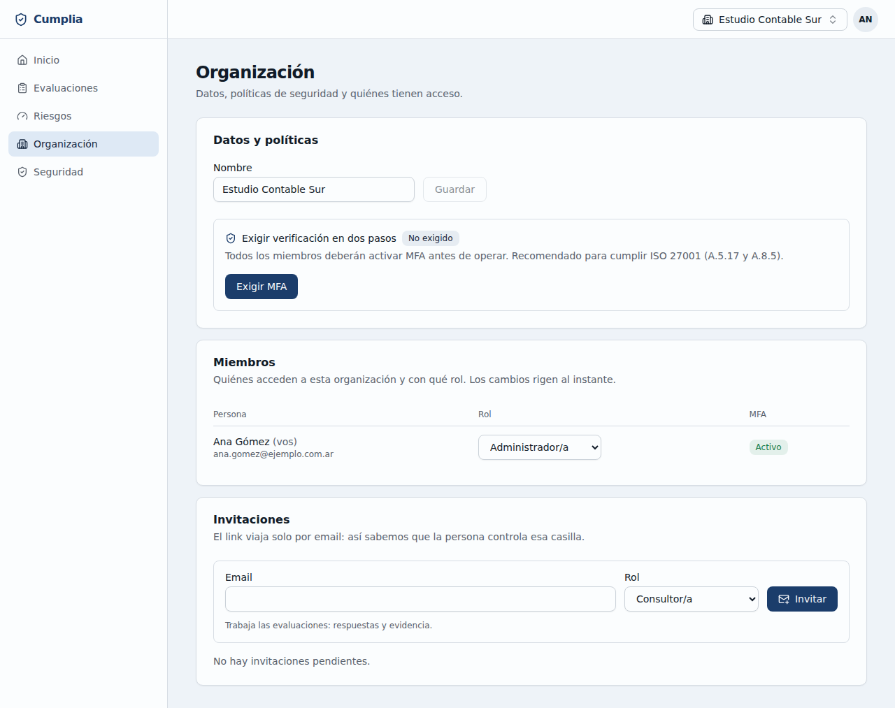
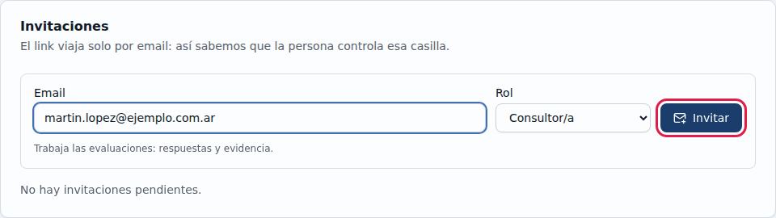
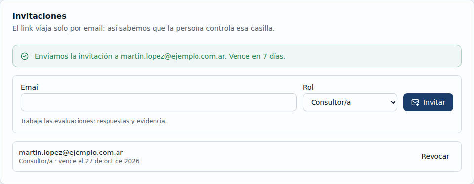
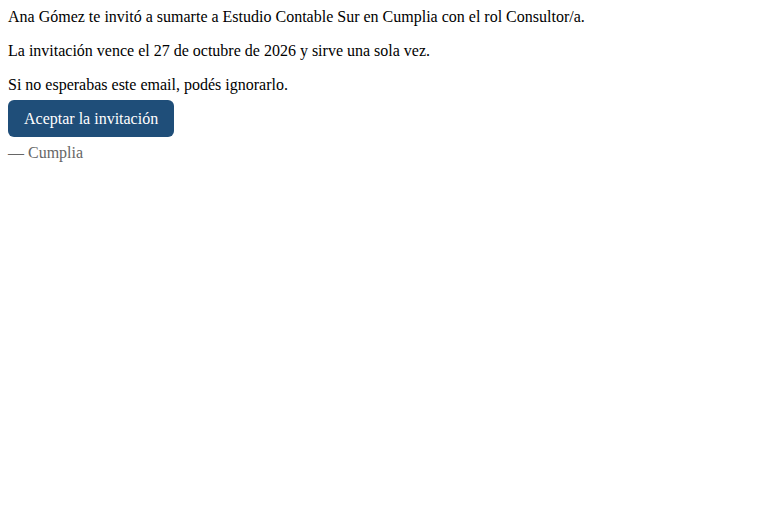
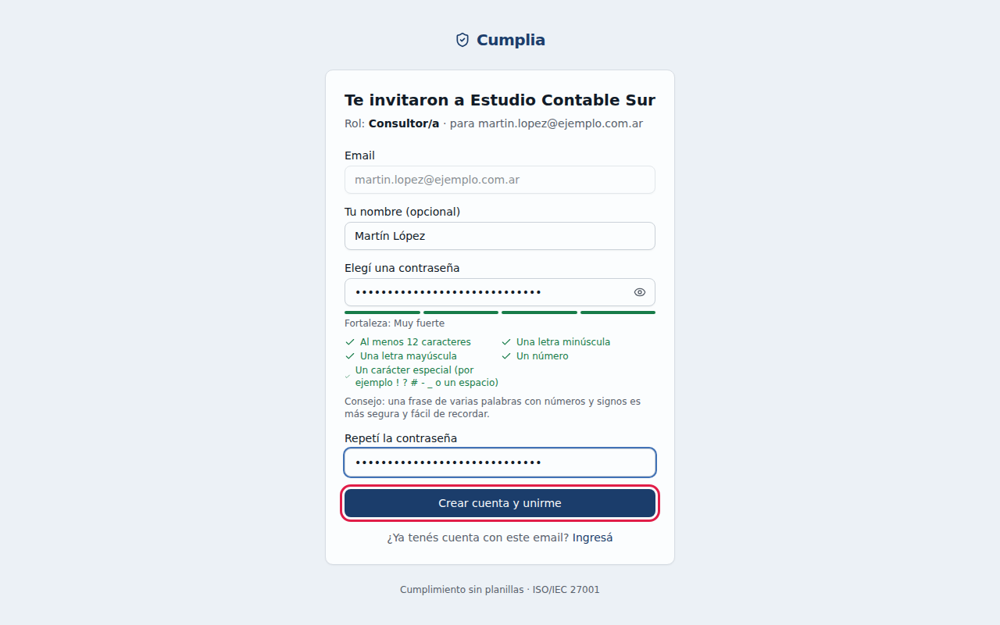
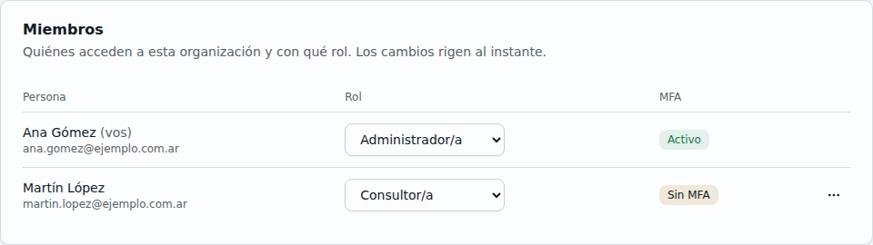
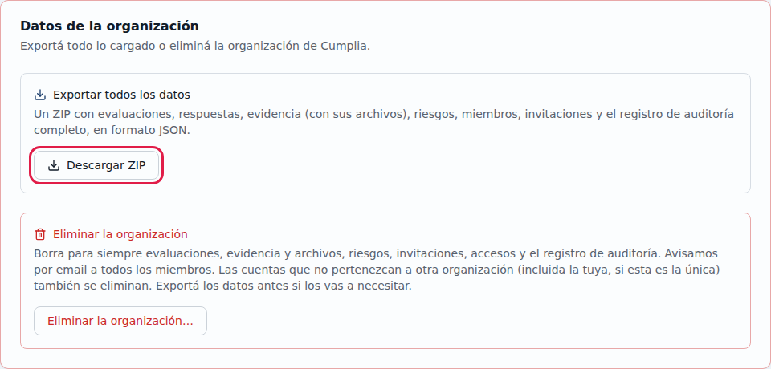

# 3. Tu organización y tu equipo

En **Organización** ves los datos y las políticas de tu organización, sus miembros y las invitaciones pendientes. Solo el **Administrador/a** puede cambiar cosas; el **Auditor/a** puede verlas.

## 3.1 Roles

| Rol | Qué puede hacer |
|---|---|
| **Administrador/a** | Todo: datos y políticas de la organización, miembros e invitaciones, evaluaciones, riesgos (incluido borrarlos) y registro de auditoría |
| **Consultor/a** | Trabaja las evaluaciones (respuestas y evidencia) y los riesgos. No administra la organización ni borra riesgos |
| **Auditor/a** | Solo lectura de todo, incluidos el registro de auditoría y la lista de miembros (para revisar accesos) |

Una organización siempre tiene al menos un Administrador/a. Los cambios de rol y las bajas rigen al instante.

## 3.2 Invitar a una persona

Para invitar tenés que ser Administrador/a y haber [confirmado tu email](01-primeros-pasos.md#12-confirmar-tu-email).

1. En **Organización** → **Invitaciones**, escribí el **Email** de la persona.
2. Elegí su **Rol**. Debajo se explica qué puede hacer cada uno.
3. Hacé clic en **Invitar**.

   

La invitación aparece como pendiente hasta que la acepten. Desde ahí podés **revocarla** si te equivocaste.

Datos útiles:
- La invitación **vence a los 7 días** y sirve **una sola vez**.
- Por seguridad, **el link viaja solo en el email**: ni vos lo ves. Así se comprueba que la persona controla esa casilla.
- Si invitás de nuevo al mismo email, el link anterior deja de servir.
- Cada organización puede enviar hasta **20 invitaciones por hora**.

## 3.3 Aceptar una invitación

1. Abrí el email **"Te invitaron a … en Cumplia"** y hacé clic en **Aceptar la invitación**.

   

2. Si es tu primera vez en Cumplia:
   - escribí tu nombre (opcional) y elegí una contraseña;
   - hacé clic en **Crear cuenta y unirme**. El email ya queda confirmado.

   

3. Si **ya tenés cuenta** con ese email:
   - ingresá primero;
   - volvé al link y hacé clic en **Unirme a …**.

   La organización se suma a las tuyas.

La invitación es para ese email: no sirve con otra cuenta.

## 3.4 Cambiar el rol o quitar a un miembro

En **Organización** → **Miembros**:
- cambiá el rol desde la lista desplegable de cada persona;
- para quitarla de la organización, abrí el menú de acciones (**···**) al final de su fila y confirmá con **Quitar acceso**.

La columna **MFA** muestra quién tiene activa la verificación en dos pasos.

Al quitar a alguien, se cierran sus sesiones en la organización. Los riesgos de los que era responsable quedan **sin asignar**; no se pierden.

## 3.5 Exigir la verificación en dos pasos a todos

En **Organización** → **Exigir verificación en dos pasos**, hacé clic en **Exigir MFA**. Desde ese momento, quien no la tenga activa solo va a poder configurarla antes de seguir trabajando. Para exigirla, primero tenés que tenerla activa vos. **Lo recomendamos**: ISO 27001 lo pide para el control de accesos (A.5.17 y A.8.5).

## 3.6 Ayudar a un miembro con su cuenta

Desde **Miembros**, en el menú de acciones (**···**) de cada persona, el Administrador/a puede:
- **Enviar link para restablecer la contraseña.** La persona elige la nueva: vos no la ves ni la fijás.
- **Cerrar sus sesiones** en esta organización. Sirve, por ejemplo, si perdió un dispositivo.
- **Restablecer su verificación en dos pasos**, si perdió el celular y los códigos. Solo se puede si esa cuenta pertenece **únicamente** a tu organización, y si vos tenés la verificación activa.

## 3.7 Trabajar con varias organizaciones

Una misma cuenta puede pertenecer a varias organizaciones; por ejemplo, un consultor/a que trabaja con varios clientes. Para pasar de una a otra:
1. hacé clic en el **nombre de la organización**, arriba a la derecha;
2. elegí la organización en **Tus organizaciones**.

Cada organización está **completamente aislada** de las demás: lo que cargás en una no se ve desde otra. Al ingresar, Cumplia te lleva a la última organización que usaste.

## 3.8 Exportar todos los datos de la organización

Los datos son de tu organización y te los podés llevar cuando quieras. En **Organización** → **Datos de la organización** → **Exportar todos los datos**, hacé clic en **Descargar ZIP**. El archivo trae:
- las evaluaciones, con la respuesta y la evidencia de cada control;
- los **archivos de evidencia**, con su huella SHA-256 para verificar que no cambiaron;
- el registro de riesgos, los miembros, las invitaciones y el **registro de auditoría completo**;
- un archivo `LEEME.txt` que explica el contenido. Los datos van en formato JSON, que otras herramientas pueden leer.

Solo el Administrador/a puede exportar, con el email confirmado. La exportación queda en el registro de auditoría.

## 3.9 Eliminar la organización

Si tu organización deja de usar Cumplia, el Administrador/a puede eliminarla con **todos** sus datos. **No se puede deshacer**: exportá los datos antes (3.8) si los vas a necesitar.

En **Organización** → **Datos de la organización** → **Eliminar la organización…**:
1. Escribí el **nombre exacto** de la organización.
2. Escribí tu **Contraseña** y, si tenés la verificación en dos pasos, el **Código de tu app** (o un código de recuperación).
3. Hacé clic en **Eliminar para siempre**.

Cumplia borra evaluaciones, evidencia y archivos, riesgos, invitaciones, accesos y el registro de auditoría, y avisa por email a todos los miembros. Las cuentas de quienes pertenecen a otras organizaciones siguen funcionando en ellas. Las cuentas que no pertenecen a ninguna otra, **incluida la tuya**, también se eliminan.
