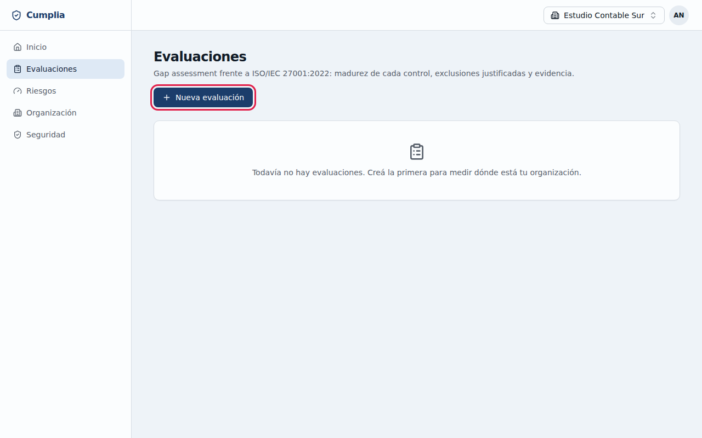
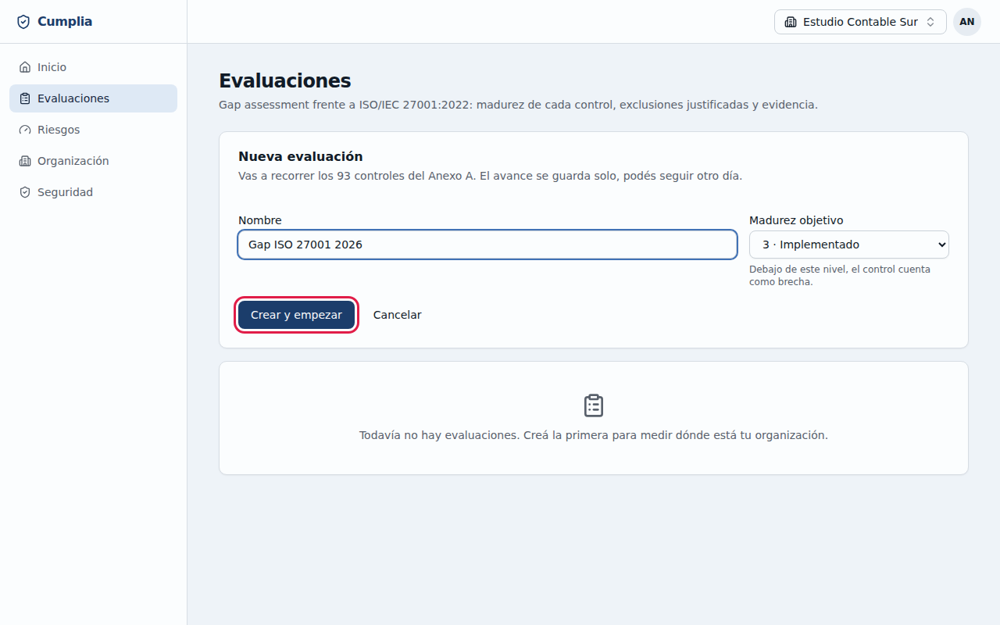
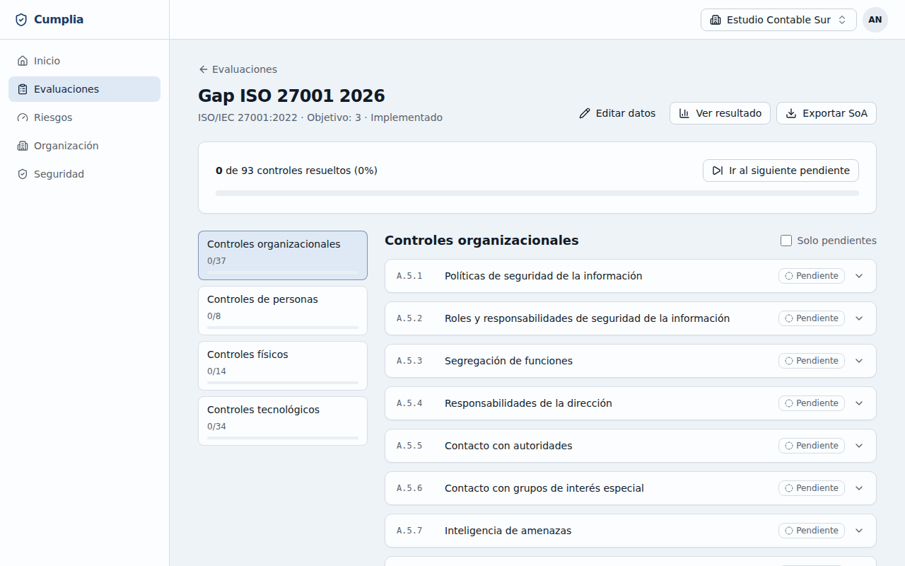
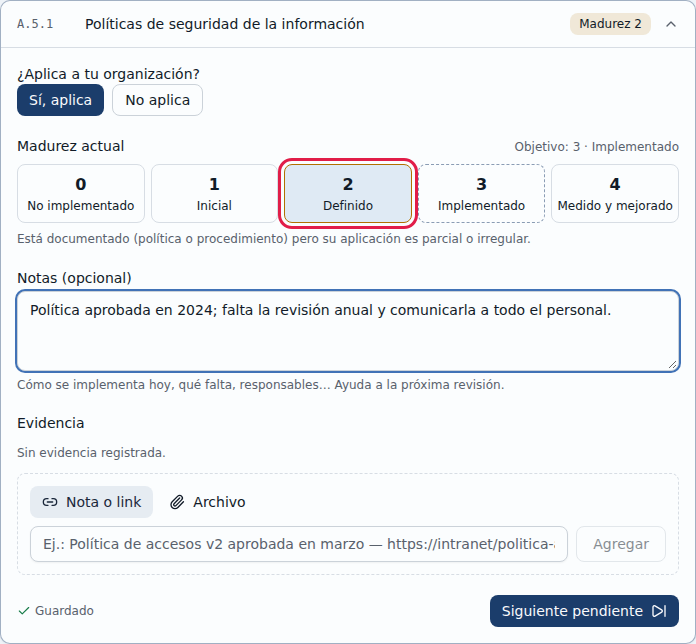
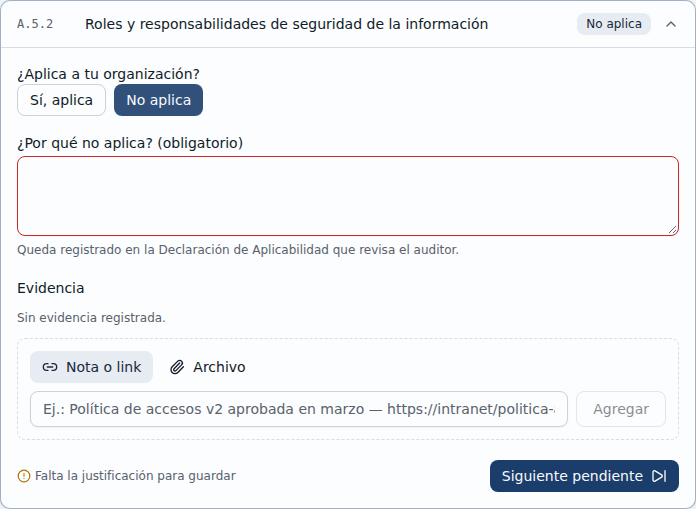
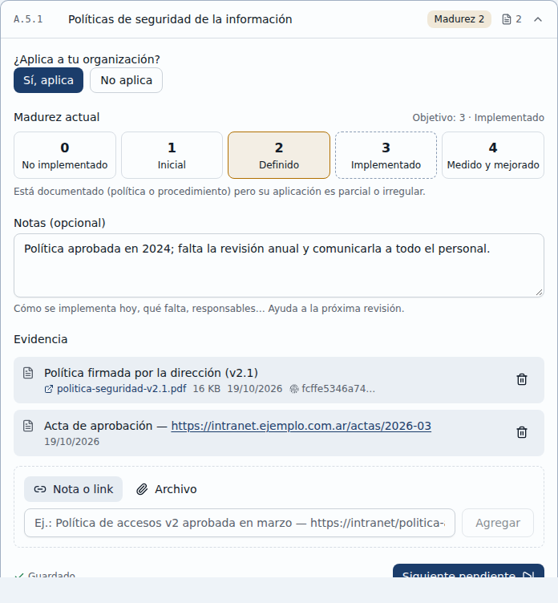
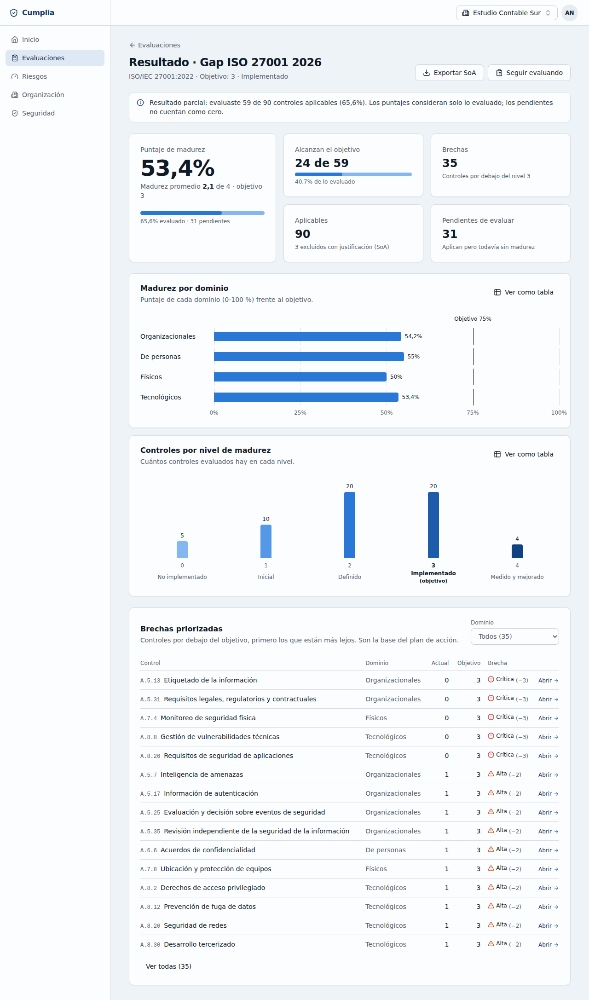
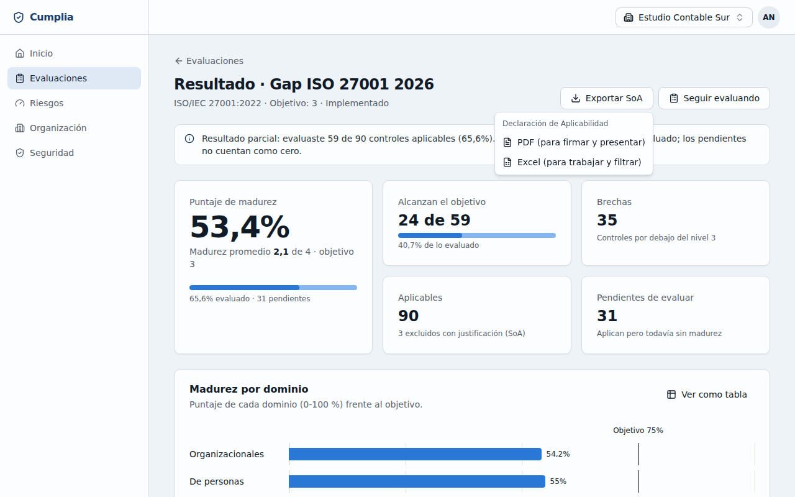

# 4. Evaluación ISO 27001

Una **evaluación** (o *gap assessment*) recorre los 93 controles del Anexo A de ISO/IEC 27001:2022. Por cada control indicás si aplica a tu organización y qué tan implementado está. Con eso Cumplia calcula tu madurez, te muestra las brechas y arma la **Declaración de Aplicabilidad (SoA)** que pide la norma.

Administradores/as y Consultores/as editan las evaluaciones; los Auditores/as las ven en modo lectura.

## 4.1 Crear una evaluación

1. Entrá a **Evaluaciones** y hacé clic en **Nueva evaluación**.

   

2. Poné un **Nombre** (por ejemplo, "Gap ISO 27001 2026").
3. Elegí la **Madurez objetivo**: el nivel que querés alcanzar. Por defecto es **3 · Implementado**; debajo de ese nivel, un control cuenta como brecha.
4. Hacé clic en **Crear y empezar**.

   

## 4.2 El asistente

El asistente muestra:
- el avance general;
- los **dominios** del Anexo A (Organizacionales, De personas, Físicos y Tecnológicos), con el avance de cada uno;
- los controles del dominio elegido.

**El avance se guarda solo**: podés seguir otro día.

- Hacé clic en un control para abrirlo.
- **Ir al siguiente pendiente** te lleva al próximo control sin responder.
- **Solo pendientes** oculta los ya resueltos.

## 4.3 Responder un control

Por cada control:
1. Indicá si **aplica a tu organización**: **Sí, aplica** o **No aplica**.
2. Si aplica, elegí la **Madurez actual**. Debajo de cada nivel ves su descripción:

   | Nivel | Significa |
   |---|---|
   | **0 · No implementado** | No existe el control o no se aplica en la práctica |
   | **1 · Inicial** | Se hace de manera informal o según la persona; no está documentado ni es consistente |
   | **2 · Definido** | Está documentado (política o procedimiento) pero su aplicación es parcial o irregular |
   | **3 · Implementado** | Documentado y aplicado de forma consistente; hay evidencia de que funciona |
   | **4 · Medido y mejorado** | Además se mide su eficacia, se revisa periódicamente y se mejora en función de los resultados |

3. Agregá **Notas** (opcional): cómo se implementa hoy, qué falta, quién es responsable. Ayudan mucho en la próxima revisión.

Cuando dice **Guardado**, la respuesta ya está registrada. Volver a hacer clic en el nivel elegido lo desmarca: el control queda pendiente.

### Si un control no aplica
Elegí **No aplica** y explicá **por qué** en el campo obligatorio. Sin esa justificación no se guarda: es lo que revisa el auditor en la Declaración de Aplicabilidad.

## 4.4 Cargar evidencia

En cada control, en **Evidencia**, podés registrar lo que demuestra cómo se aplica:
- **Nota o link**: un texto, por ejemplo "Política de accesos v2 aprobada en marzo", con un link a donde está el documento.
- **Archivo**: una captura de pantalla, foto o PDF de hasta **10 MB**, en formato PNG, JPG, WebP o PDF. Arrastralo o hacé clic para elegirlo, agregá una descripción y hacé clic en **Subir**.

Cada archivo guarda una **huella digital** (SHA-256). Con ella podés demostrar ante un auditor que el archivo no cambió desde que lo cargaste. Para borrar una evidencia, usá el ícono de la papelera.

## 4.5 Ver el resultado

Desde la evaluación, hacé clic en **Ver resultado**. El tablero muestra:
- **Puntaje de madurez** y madurez promedio, calculados **sobre lo ya evaluado** (los controles pendientes no cuentan como cero);
- cuántos controles **alcanzan el objetivo**, cuántas **brechas** hay y cuántos quedan **pendientes**;
- la **madurez por dominio**, con la línea del objetivo;
- cuántos controles hay **en cada nivel**;
- las **brechas priorizadas**, de la más grande a la más chica. Es la base de tu plan de acción. **Abrir** te lleva directo a ese control en el asistente.

Cada gráfico tiene **Ver como tabla**, con los mismos datos en una tabla.

## 4.6 Exportar la Declaración de Aplicabilidad

Hacé clic en **Exportar SoA** y elegí el formato:
- **PDF**: para firmar y presentar.
- **Excel**: para trabajar y filtrar. Trae el resumen, la Declaración de Aplicabilidad y las brechas.

La SoA incluye, por cada control:
- si aplica;
- la justificación de su inclusión o exclusión;
- su estado de implementación;
- cuántas evidencias tiene.

Para exportar tenés que haber confirmado tu email. Cada exportación queda en el registro de auditoría.
