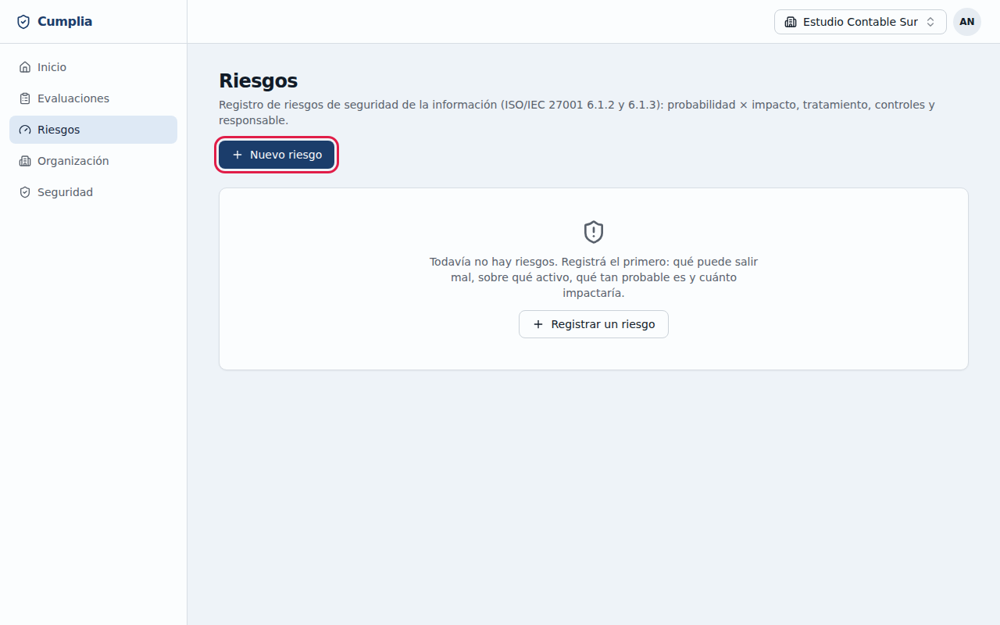
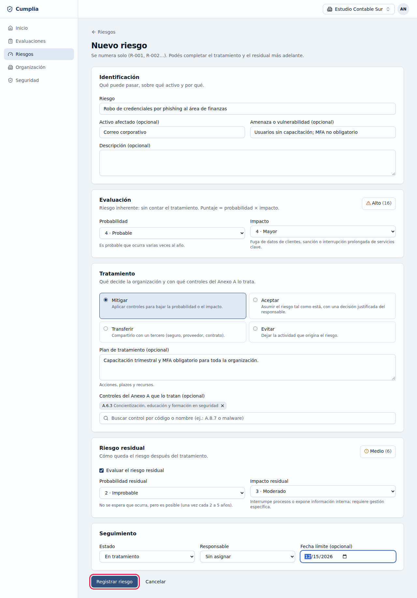
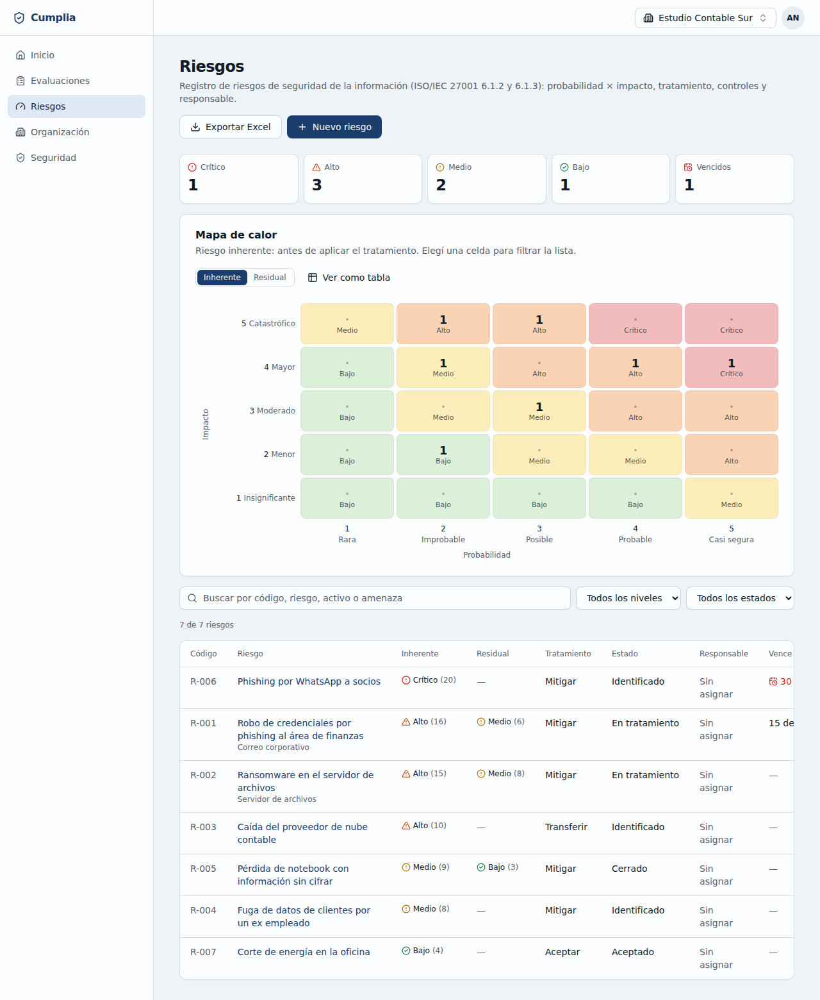
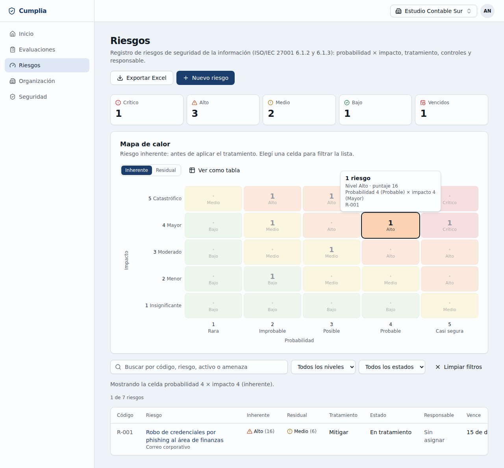
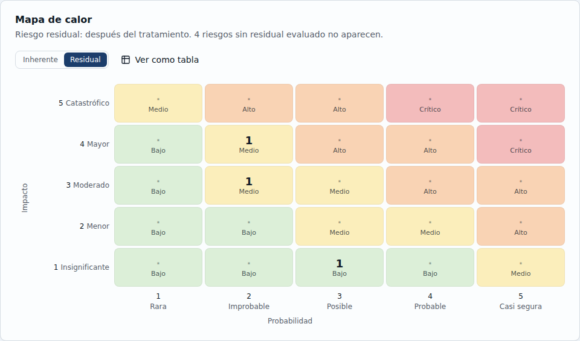
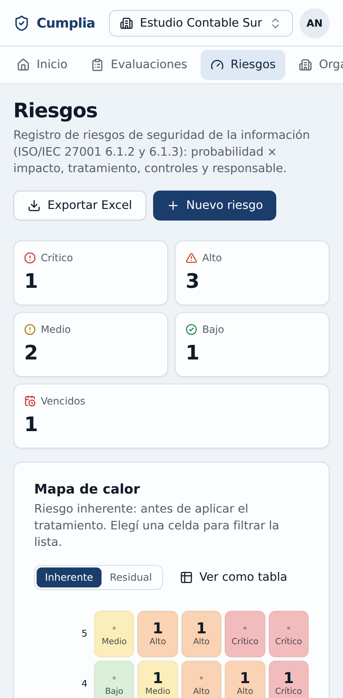

# 5. Registro de riesgos

ISO 27001 pide identificar los riesgos de seguridad de la información, evaluarlos y decidir cómo tratarlos (cláusulas 6.1.2 y 6.1.3). En **Riesgos** llevás ese registro.

Administradores/as y Consultores/as registran y editan riesgos; solo el Administrador/a puede borrarlos; los Auditores/as los ven.

## 5.1 Cómo se evalúa un riesgo

Cada riesgo se califica con dos valores del 1 al 5:
- **Probabilidad**: qué tan posible es que ocurra, de **1 · Rara** (excepcional) a **5 · Casi segura** (mensual o más).
- **Impacto**: cuánto daño haría, de **1 · Insignificante** a **5 · Catastrófico** (amenaza la continuidad del negocio).

El **puntaje** es probabilidad × impacto (de 1 a 25) y define el **nivel**:

| Puntaje | Nivel |
|---|---|
| 1 a 4 | **Bajo** |
| 5 a 9 | **Medio** |
| 10 a 16 | **Alto** |
| 17 a 25 | **Crítico** |

- El riesgo **inherente** es el que existe hoy, antes de tratarlo.
- El **residual** es el que queda después de aplicar el tratamiento.

## 5.2 Registrar un riesgo

1. Entrá a **Riesgos** y hacé clic en **Nuevo riesgo**.

   

2. En **Identificación**, describí:
   - el **Riesgo**: qué puede pasar, por ejemplo "Robo de credenciales por phishing al área de finanzas";
   - el **Activo afectado** y la **Amenaza o vulnerabilidad**, opcionales.
3. En **Evaluación**, elegí la **Probabilidad** y el **Impacto**. Arriba a la derecha ves el **nivel** calculado en el momento.
4. En **Tratamiento**, elegí qué decide la organización:
   - **Mitigar**: aplicar controles para bajar la probabilidad o el impacto.
   - **Aceptar**: asumir el riesgo como está. **Exige escribir la justificación** de la decisión y quién la aprobó.
   - **Transferir**: compartirlo con un tercero (seguro, proveedor, contrato).
   - **Evitar**: dejar la actividad que origina el riesgo.

   Escribí el **Plan de tratamiento** y, si querés, buscá y agregá los **controles del Anexo A** que lo tratan (por código, como "A.8.7", o por nombre, como "malware").
5. En **Riesgo residual**, marcá **Evaluar el riesgo residual** para indicar cómo queda el riesgo después del tratamiento.
6. En **Seguimiento**, elegí:
   - el **Estado**: Identificado, En tratamiento, Aceptado o Cerrado. *Aceptado* solo vale con el tratamiento *Aceptar*;
   - el **Responsable** (un miembro de la organización);
   - una **Fecha límite**, opcional.
7. Hacé clic en **Registrar riesgo**. Cumplia le asigna un código correlativo: R-001, R-002, etc.

## 5.3 La lista y el mapa de calor

En **Riesgos** ves:
- **cuántos riesgos hay de cada nivel** y cuántos tienen la **fecha límite vencida** (sin cerrar ni aceptar);
- el **mapa de calor**: la matriz de 5×5 con cuántos riesgos hay en cada combinación de probabilidad e impacto;
- la **lista de riesgos**, del más grave al menos grave.

Podés:
- **Hacer clic en una celda del mapa** para ver solo los riesgos de esa celda. Volvé a hacer clic, o usá **Limpiar filtros**, para verlos todos.

  

- Pasar de **Inherente** a **Residual** para ver cómo queda el mapa después del tratamiento. Los riesgos sin residual evaluado no aparecen en esa vista.

  

- **Buscar** por código, nombre, activo o amenaza, y **filtrar** por nivel o estado.
- Usar **Ver como tabla** para tener el mapa en una tabla.
- **Exportar Excel**, con un resumen con la matriz y la lista completa filtrable. Requiere el email confirmado.

Para **editar** un riesgo, hacé clic en su nombre, cambiá lo necesario y hacé clic en **Guardar cambios**. El Administrador/a puede **borrarlo** desde la misma pantalla; queda registrado en la auditoría.

## 5.4 En el celular

Cumplia funciona en el celular: el menú pasa arriba y la lista de riesgos se muestra como tarjetas.

