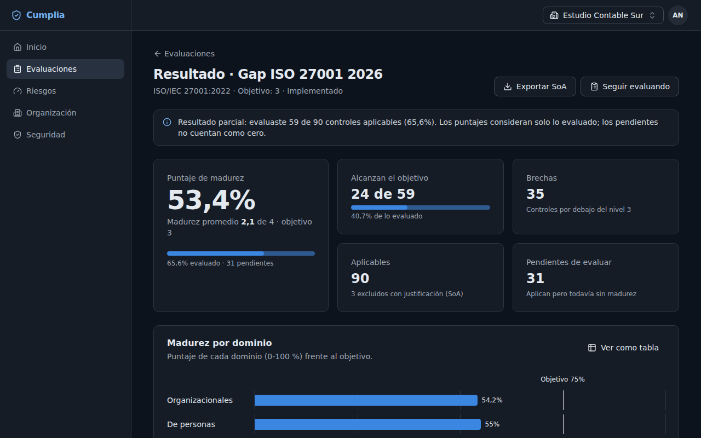

# 6. Preguntas frecuentes

**¿Cumplia certifica a mi organización en ISO 27001?**
No. Cumplia te ayuda a prepararte: medir la madurez, documentar la Declaración de Aplicabilidad, gestionar riesgos y reunir evidencia. La certificación la otorga un organismo certificador acreditado después de una auditoría.

**¿Alguien de otra organización puede ver mis datos?**
No. Cada organización está aislada de las demás en varias capas, y eso se prueba automáticamente en cada cambio del software. Aunque una persona pertenezca a dos organizaciones, lo que carga en una no aparece en la otra.

**No me llega el email.**
- Revisá la carpeta de spam o correo no deseado.
- Para la confirmación de la cuenta, usá **Reenviar el link** en el aviso de la pantalla de inicio.
- Para una invitación, pedile al Administrador/a que te invite de nuevo.

**El link dice que "no es válido o ya venció".**
Los links sirven una sola vez y vencen:
- recuperar la contraseña: 30 minutos;
- confirmar el email: 24 horas;
- invitación: 7 días.

Si pediste dos, solo sirve el último. Pedí uno nuevo.

**Mi cuenta quedó bloqueada.**
Después de 5 intentos fallidos se bloquea por 15 minutos. Esperá y probá de nuevo, o usá **¿Olvidaste tu contraseña?**.

**Cambié de celular / perdí el celular.**
- Si todavía podés ingresar, desactivá y volvé a activar la verificación en dos pasos desde **Seguridad**, con el celular nuevo.
- Si no podés ingresar, usá un **código de recuperación**.
- Si tampoco los tenés, pedile al Administrador/a que restablezca tu verificación en dos pasos.

**Me sacó de la sesión sin que hiciera nada.**
Las sesiones se cierran solas tras 12 horas sin uso, y como máximo a los 7 días. También se cierran si cambiás la contraseña, si activás la verificación en dos pasos (las de otros dispositivos) o si el Administrador/a cierra tus sesiones.

**No veo el botón para invitar, exportar o borrar.**
- Invitar y exportar requieren tener el **email confirmado**.
- Invitar y borrar riesgos son acciones del **Administrador/a**.
- El rol **Auditor/a** es de solo lectura.

**¿Qué pasa si una persona deja la organización?**
El Administrador/a la quita desde **Organización** → **Miembros**: pierde el acceso al instante. Sus respuestas y la evidencia que cargó se mantienen. Los riesgos de los que era responsable quedan sin asignar.

**¿Puedo usar Cumplia para varios clientes (soy consultor/a)?**
Sí. Cada cliente es una organización. Pedí que te inviten a cada una, o creá las tuyas, y cambiá entre ellas desde el nombre de la organización, arriba a la derecha.

**¿Qué formatos de evidencia acepta?**
Imágenes PNG, JPG o WebP y documentos PDF, de hasta 10 MB cada uno. También notas con links.

**¿Puedo usar Cumplia con el tema oscuro?**
Sí. En tu menú de usuario elegí **Tema** → **Oscuro**, **Claro** o **Según el sistema**.

**¿Dónde reporto un problema de seguridad?**
Escribí a la dirección de seguridad indicada en la Política de Privacidad. No lo publiques en redes ni foros: así podemos corregirlo antes de que alguien lo aproveche.
